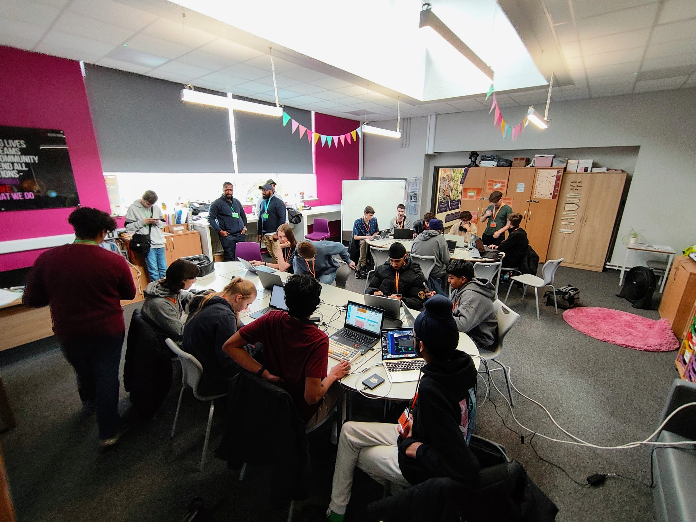
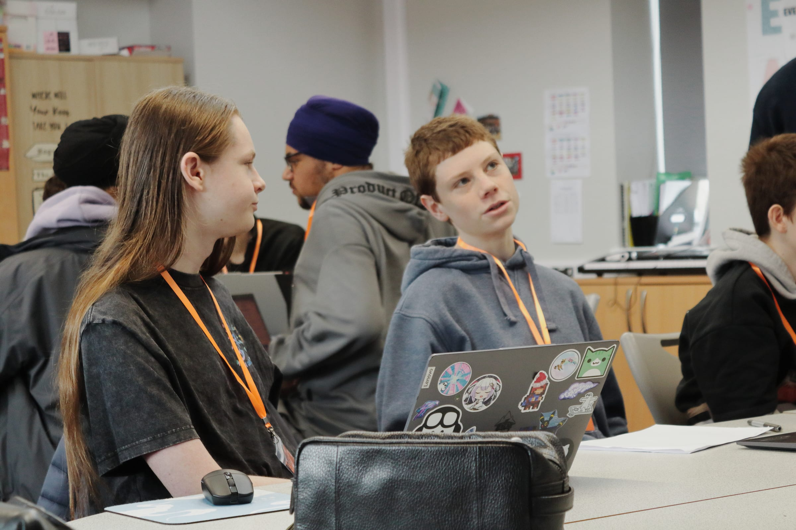
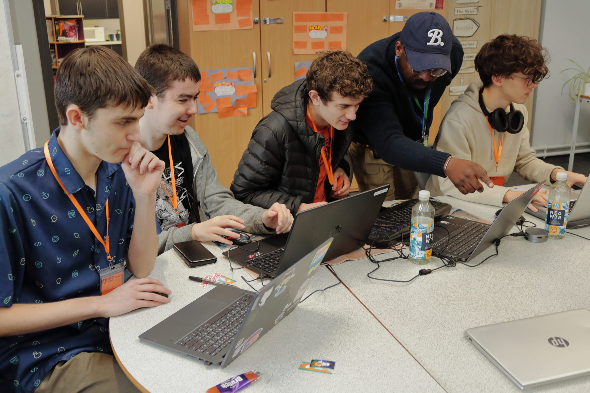
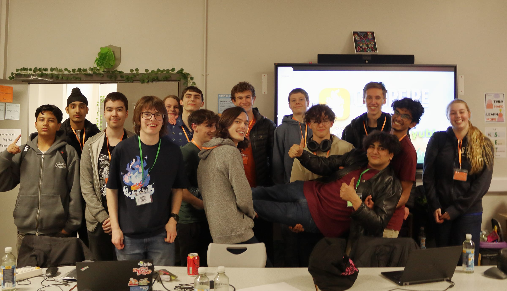

On Saturday 28 February, 14 students aged 13 to 18 from across the West Midlands spent 12 hours at Ormiston Sandwell Community Academy building games from scratch. Campfire Birmingham was a Hack Club satellite event that I organised through Refract Foundation, with a team of 6 volunteers, and the theme for the day was **“beneath the surface”**.

By the end, 6 games had been shipped, and for many of the attendees it was their first hackathon and their first lines of code.

## Getting there

The event was the result of several months of preparation. I spent a significant amount of time securing the venue, coordinating with partners and sponsors, planning logistics and developing the structure of the day. Alongside this, there was marketing and outreach to schools and students to make sure the event reached the right audience.

At points during the build-up, there was uncertainty about whether everything would come together. Seeing the room reach capacity on the day made the effort worthwhile.

## How the day worked

Attendees collaborated in teams, attended workshops and rapidly turned ideas into playable games. The atmosphere was highly supportive, with participants learning from each other as much as from the structured sessions.

One of the most striking outcomes was how quickly they adapted to building under pressure. Ethan Hawksley, one of the event winners, described his experience as:

> “Over a short period, I had helped transform a group of enthusiastic Year 12 students into confident programmers capable of breaking down and solving complex problems.”

That shift from uncertainty to capability was visible across the room.

## The games

Six games came out of the day, each taking the theme in a different direction, from narrative-driven experiences to fast-paced gameplay:

1. **[Cat-Fishing Frenzy](https://ethanhawksley.itch.io/cat-fishing-frenzy)** by Ethan, Ryley & Sam, which won the event
2. **[A Gneiss Expedition](https://icefly147.itch.io/a-gneiss-expedition-demo)** by Shàven, Adam & Amelia, in second
3. **[Curiosity Calls](https://jacob-hawksley.itch.io/curiosity-calls)** by Jacob & Robert, in third
4. **[Limbo](https://gh0st1yyy.itch.io/limbo)** by Josh, Archie & Fin
5. **[HarryJumpz](https://notharridham.itch.io/harryjumpz)** by Harridham & Neil
6. **[Rage Quitting Football](https://gurjot11.itch.io/rage-qutting-football)** by Gurjot

Ethan described how the winning team approached it:

> “We began the event by first creating the assets we would need. After not too long, we had created the skeleton of a fully functional game.”

## Thank you

Campfire Birmingham would not have happened without:

- [Alfie](https://www.linkedin.com/in/alfie-barlow-404935379/), UK Regional Manager at Hack Club
- [Owhonda](https://www.linkedin.com/in/owhondanwokekoro/), [Dipesh](https://www.linkedin.com/in/dipeshthapa07/) and [Boma](https://www.linkedin.com/in/bomapeters/), mentors from [Cyber Heroez CIC](https://cyberheroez.co.uk/)
- [Paramveer](https://www.linkedin.com/in/paramveersi/) from [HackUK](https://www.hackuk.network/) and [Preston](https://www.linkedin.com/in/preston-saunders-1990b83a6/), co-hosts and mentors who gave their time on the day
- [Yubico](https://www.yubico.com/), for donating YubiKeys and supporting cybersecurity education for attendees
- Mrs James and Mr Lovatt from [Ormiston Sandwell Community Academy](https://ormistonsandwell.org.uk/), for providing a welcoming venue and continued support
- [Hack Club](https://hackclub.com/) and [Open Sauce](https://www.opensauce.com/), for creating the Campfire initiative in the first place

## What it showed

Campfire Birmingham demonstrated what can be achieved when young people are given time, tools and trust. In just 12 hours, complete beginners and experienced coders alike collaborated, learned new skills and brought ideas to life.

It reinforced a core principle of Refract's work: opportunity and access matter as much as ability. When those are in place, young people consistently exceed expectations.

You can find the full set of projects and photos on the [Campfire Birmingham page](/our-work/campfire). If you would like to help us run the next one, as a mentor, a sponsor or a venue, [get in touch](/contact).
