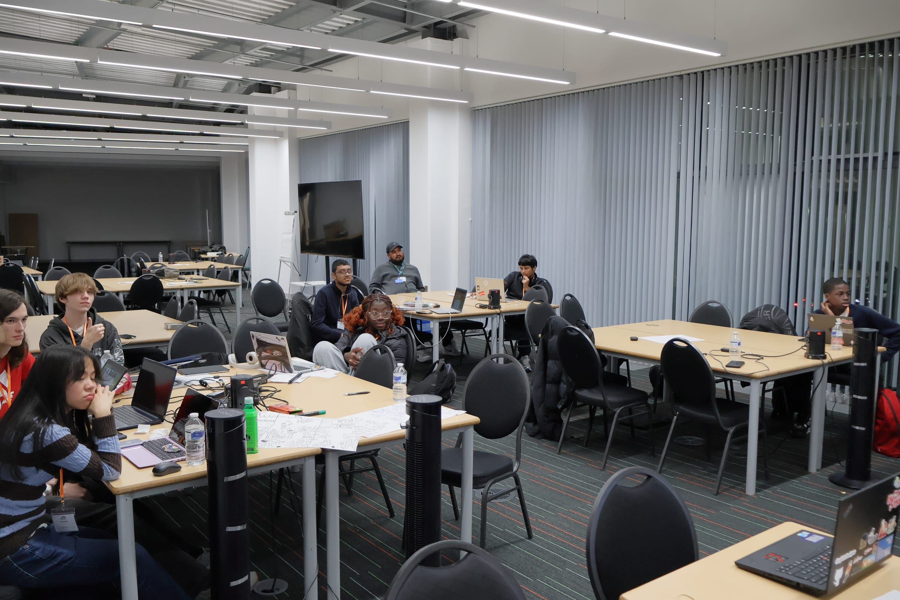
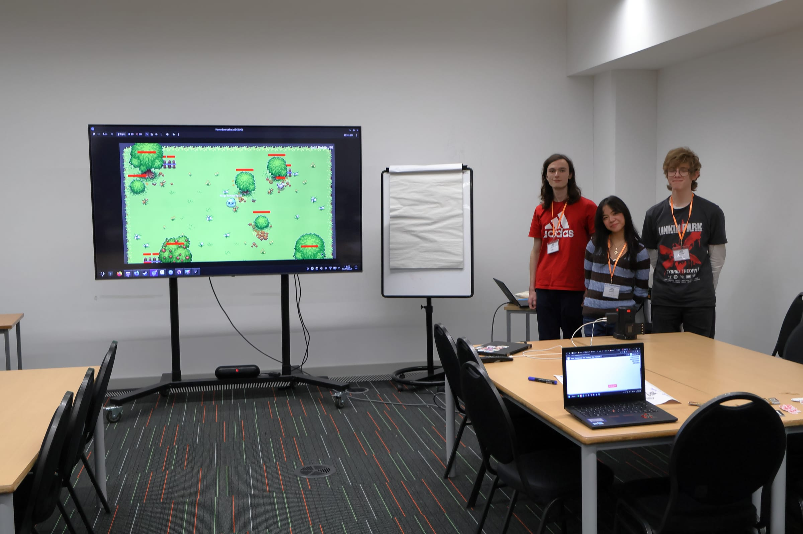
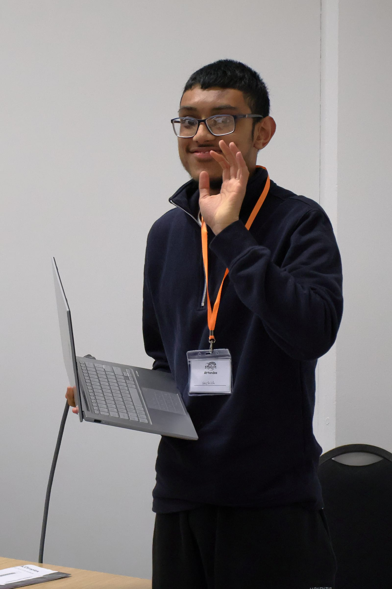
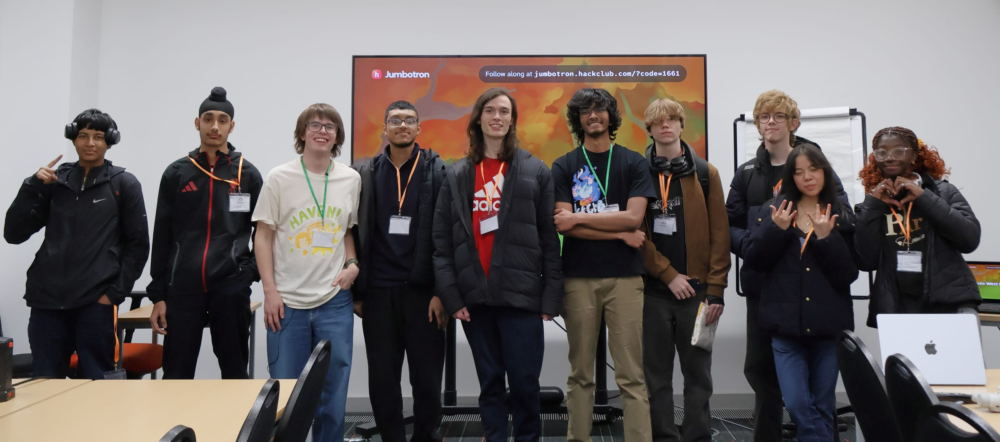

On Saturday 14 November, ten teenagers aged 13 to 18 spent the day at the University of Wolverhampton Science Park building video games from scratch. Haven West Midlands was our second Hack Club event, following Campfire Birmingham in February, and this time the brief was a single theme: **“Bounce Back”**.

By the end of the 12 hours, the room had produced six finished, playable games, all of them published online for anyone to try.

## How the day worked

Haven is a teen game jam run by [Hack Club](https://hackclub.com), the global nonprofit network of teen coders. Local events like ours are organised by volunteers, and ours was run by a team of five: [myself](https://www.linkedin.com/in/opott/), [Preston](https://www.linkedin.com/in/preston-saunders-1990b83a6/) and [Shaven](https://www.linkedin.com/in/shavenwickramanayaka/) as organisers, with Owhonda and Dipesh from [Cyber Heroez CIC](https://cyberheroez.co.uk/) mentoring on the day.

Attendees worked alone or in small teams, supported by workshops, lightning talks and hands-on help from the volunteers. The day finished with each team presenting their game to the room, followed by a peer vote.

## The games

Six games came out of the day, each taking the theme in a different direction:

1. **[Escape for your Life](https://sadev321.itch.io/escape-for-your-life)** by Sachith, which took first place in the peer vote
2. **[Let’s Bounce on It](https://nulkai.itch.io/pogo-no-go)** by Kai & Lawrencia, in second
3. **[Splattershot: Send it!](https://auseawesome.itch.io/splattershot-send-it)** by Adam, Misha & Sofia, in third
4. **[Bounce Back](https://tiotech.itch.io/bounce-back)** by Tio
5. **[HarrySneakz](https://notharridham.itch.io/harrysneakz)** by Harridham
6. **[FloppyCat](https://p1ze.itch.io/floppycat)** by Neil

Every one of them is playable in the browser, so please try them and leave the makers a comment. Feedback from strangers is one of the best parts of publishing a game, and it means a lot at this stage.

## Thank you

Haven only happened because of the people and organisations behind it:

- The organising team: [Oliver](https://www.linkedin.com/in/opott/), [Shaven](https://www.linkedin.com/in/shavenwickramanayaka/) and [Preston](https://www.linkedin.com/in/preston-saunders-1990b83a6/)
- [Hack Club](https://hackclub.com/), for creating Haven and supporting local organisers, and in particular [Aly](https://www.linkedin.com/in/aly-kotb/), an event manager there who was incredibly helpful throughout
- [Cyber Heroez CIC](https://cyberheroez.co.uk/), whose mentors Owhonda and Dipesh gave their day to the attendees
- [RedOps](https://redops.co.uk), [CodeCrafters](https://codecrafters.io) and [gen.xyz](https://gen.xyz), for the free food and prizes
- The events team at the University of Wolverhampton Science Park, for hosting us and looking after us on the day
- Every attendee, for turning up on a Saturday and shipping a game

You can find the full set of projects and photos on the [Haven West Midlands page](/our-work/haven). If you would like to help us run the next one, as a mentor, a sponsor or a venue, [get in touch](/contact).
